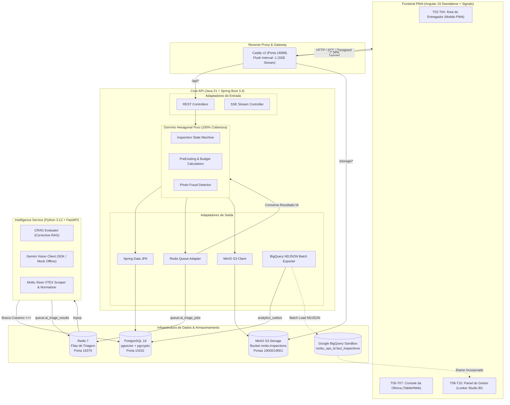

# Mottu Smart Ops — Sistema de Vistoria Inteligente, Telemetria & Operação de Frota

[](https://openjdk.org/)
[](https://spring.io/projects/spring-boot)
[](https://www.python.org/)
[](https://fastapi.tiangolo.com/)
[](https://angular.dev/)
[](https://tailwindcss.com/)
[](https://github.com/pgvector/pgvector)
[](https://redis.io/)
[](https://min.io/)
[](https://caddyserver.com/)
[](https://www.docker.com/)
[-00E676?style=for-the-badge&logo=vitest&logoColor=06120B)](#-qualidade-de-código--bateria-de-testes)

> **Case Operacional e Técnico de Alto Impacto para a Maior Plataforma de Locação de Motos da América Latina.**  
> Solução integrada ponta a ponta para eliminar filas de galpão, automatizar triagem de avarias com IA Multimodal (Gemini Vision + CRAG), prevenir fraudes de imagens e conectar telemetria de oficina ao Google BigQuery & Looker Studio.

---

## 📌 Visão Executiva & Impacto de Negócio

Em operações de alta escala com mais de **50.000 motocicletas ativas rodando 14h/dia**, **moto parada na oficina é prejuízo duplo**: receita cessante para a empresa e perda de faturamento diário para o entregador parceiro.

O **Mottu Smart Ops** transforma o processo físico tradicional de vistoria em uma experiência digital ultrarrápida com governança matemática estrita:

* ⏱️ **Triagem Autônoma em 5 Segundos:** A IA classifica a avaria direto pelo celular e consulta o catálogo oficial da Mottu Store (`loja.mottu.com.br`).
* 🎯 **78,5% de Deflexão Operacional:** Casos óbvios são resolvidos na hora sem necessidade de intervenção do mecânico humano.
* ⚖️ **Orçamento Transparente e Sem Atritos:**
  * **Pré-existente (`PRE_EXISTENTE`):** Contrato recente ($\le 48\text{h}$ ou $\le 100\text{km}$) $\rightarrow$ **R$ 0,00 (Gratuito)**.
  * **Desgaste Natural (`DESGASTE_NATURAL`):** Peças de consumo rotineiro (pastilha, lona, kit relação) $\rightarrow$ **R$ 0,00 (Gratuito)**.
  * **Mau Uso ou Queda (`MAU_USO`):** Peças canônicas tabeladas + taxa fixa de mão de obra (R$ 35,00) $\rightarrow$ **Orçamento oficial imediato**.
* 🛡️ **Defesa Anti-Fraude com Hash Perceptual (`pHash`) e Metadados:** Bloqueia reutilização de fotos antigas ou imagens baixadas da internet.
* 🛠️ **Mesa de Decisão do Mecânico com Lupa de Zoom Reticular (T06):** Fila inteligente priorizada por severidade (P1 Segurança a P4 Suspeita de Fraude), liberando mais de **36 horas de oficina por semana**.
* 📊 **Governança com BigQuery & Looker Studio:** Exportação assíncrona via Transactional Outbox em formato NDJSON para painéis executivos em tempo real.

---

## 🏗️ Arquitetura do Sistema



---

## 🚀 Início Rápido (1 Comando Docker)

O projeto foi construído para subir de forma **100% autônoma, local e gratuita** (com o modo simulado offline `GEMINI_MOCK_MODE=true` e `BIGQUERY_ENABLED=false` ativado por padrão):

```bash
# 1. Clone o repositório
git clone https://github.com/seu-usuario/mottu-smart-ops.git
cd mottu-smart-ops

# 2. Copie o arquivo de ambiente padrão
cp .env.example .env

# 3. Suba toda a stack de desenvolvimento com 1 comando
docker compose -f infra/docker-compose.dev.yml up -d
```

### 🌐 Mapeamento de Portas e Serviços Locais

| Serviço | URL / Endpoint Local | Descrição |
| :--- | :--- | :--- |
| **Aplicação Web (Angular 19 PWA)** | [`http://localhost:18088`](http://localhost:18088) | Porta principal via proxy reverso Caddy |
| **Backend Core API (Java Spring)** | [`http://localhost:18080`](http://localhost:18080) | API REST e endpoints de domínio |
| **Swagger / OpenAPI (Core API)** | [`http://localhost:18080/swagger-ui.html`](http://localhost:18080/swagger-ui.html) | Documentação interativa dos contratos REST |
| **Intelligence Service (FastAPI)** | [`http://localhost:18000`](http://localhost:18000) | Serviço de IA, CRAG e scrapers |
| **Swagger / OpenAPI (Intelligence)**| [`http://localhost:18000/docs`](http://localhost:18000/docs) | Documentação interativa da API de IA |
| **MinIO Console (S3 Storage)** | [`http://localhost:19001`](http://localhost:19001) | Painel web de fotos (`minioadmin` / `minioadmin123`) |
| **PostgreSQL 16 + pgvector** | `localhost:15432` | Banco transacional (`mottu_ops` / senha `.env`) |
| **Redis 7 (Filas & Mensageria)** | `localhost:16379` | Broker de mensagens leve para triagem IA |

---

## 🔑 Credenciais Seed Prontas para Teste

O banco de dados já inicializa com dados pré-populados (`V2__seed_data.sql`). Todas as contas utilizam a senha canônica do projeto:

> 🔐 **Senha Padrão para Todos os Perfis:** `Mottu@2026!`

| Perfil | E-mail de Acesso | Moto / Contrato Vinculado | Papel no Sistema |
| :--- | :--- | :--- | :--- |
| **Gestor (Manager)** | `gestor@mottu-ops.local` | Acesso Global a Todas as Unidades | Aprovação de usuários, catálogo de peças Mottu Store e Looker Studio BI |
| **Mecânico (Mechanic)** | `mecanico@mottu-ops.local` | Galpão Butantã (São Paulo) | Fila priorizada (P1-P4), mesa de decisão com zoom e gestão da frota |
| **Entregador (Rider)** | `entregador@mottu-ops.local` | Moto `MOT1A23` (*Mottu Sport 110i*, 12h de uso, 1.000 km) | Telemetria da moto, wizard de vistoria, resultado SSE e agendamento |

---

## 📱 Catálogo de Telas do Sistema (`T01` a `T10`)

O sistema segue com fidelidade cirúrgica o arquivo de design `design/mottu-smart-ops.pen` e o Design System **Mottu Asphalt Telemetry** (`DESIGN.md`): fundo asfalto escuro `#0A0E0D`, verde Mottu `#00E676`, contraste solar 11.45:1, botões de 52px+ para operação com luvas e **proibição estrita de cores roxas/violetas** (*Purple Ban*).

### 🚪 Autenticação & Acesso Público
* **`T01` — Login & Solicitação de Cadastro:** Autenticação unificada com JWT. Aba de solicitação de cadastro com validação de CPF e telefone para `RIDER` ou `MECHANIC` (aguardando liberação do Gestor). Suporte a *Modo Demonstração Público*.

### 🛵 Portal do Entregador (Mobile PWA para Celular)
* **`T02` — Minha Moto (Garagem Digital):** Placa em destaque em tipografia mono 32px, odômetro atual, dias de contrato, status de circulação e histórico de vistorias com travas para no máximo 3 chamados simultâneos.
* **`T03` — Nova Vistoria (Wizard Ergonômico de 3 Passos):** Staging com 4 slots de fotos (Frente, Traseira, Lateral Direita, Lateral Esquerda), pré-validador de luminosidade via canvas (alerta fotos escuras), perguntas objetivas de contexto (`JA_RECEBI_ASSIM`, `USO_NORMAL`, `QUEDA_BATIDA`), toggle de risco de segurança e envio com chave de idempotência.
* **`T04` — Resultado da Vistoria & Agendamento:** Barra de progresso ao vivo via Server-Sent Events (SSE), orçamento transparente discriminando peças e mão de obra, modal de agendamento de galpão (data futura e turno) e botão único de contestação *"Discordo do resultado"* (mínimo 10 caracteres).

### 🔧 Console da Oficina (Tablet / Desktop do Mecânico)
* **`T05` — Fila Inteligente da Oficina:** Lista ordenada estritamente por criticidade operacional:
  1. 🔴 **P1: Risco de Segurança / Moto Parada** (`#FF4D4F`)
  2. 🟠 **P2: Contestação do Entregador ("Discordo")** (`#FFB300`)
  3. 🟡 **P3: Dúvida da IA (< 80% de Certeza)** (`#FFB300`)
  4. 🔵 **P4: Suspeita de Fraude / Foto Repetida** (`#29B6F6` — *sem roxo*)
  * Exibe taxa de deflexão da IA (78,5% resolvidos sem intervenção humana) e filtros instantâneos.
* **`T06` — Mesa de Decisão do Mecânico:** Layout assimétrico (55% / 45%). Lado esquerdo com foto em alta definição e **lupa reticular central de zoom interativo (2x a 4x)**, caixas delimitadoras da IA (`bounding boxes`), contexto da retirada e alerta de fraude. Lado direito com veredito editável em 1 clique, checklist de peças com recálculo automático de orçamento via Signals e campo de parecer técnico que a IA converte em mensagem empática.
* **`T07` — Inventário e Gestão da Frota:** Painel de motocicletas do galpão por status (`AVAILABLE`, `RENTED`, `IN_MAINTENANCE`), ações rápidas de transição de estado e modal de cadastro de novas motos com validação de placa Mercosul.

### 👔 Painel Executivo do Gestor (Desktop)
* **`T08` — Gestão de Acessos & Aprovações:** Fila de cadastros pendentes com distinção visual. Ao aprovar um entregador, exige a seleção obrigatória de uma moto disponível no galpão para emissão automática do contrato de locação. Modal de recusa com justificativa.
* **`T09` — Catálogo Oficial Mottu Store (`loja.mottu.com.br`):** Botão CTA de sincronização em tempo real com a API VTEX da Mottu Store. Configuração da taxa padrão de mão de obra (R$ 35,00), busca textual, filtros por modelo e edição inline de preços com proteção de sobrescrita (`priceOverridden = true`).
* **`T10` — Inteligência Operacional & Looker Studio BI:** 4 cards de telemetria em tempo real (Motos Ativas, % Resolvido pela IA, Fila Atual da Oficina, Horas Economizadas) e **Iframe responsivo de 640px do Google Looker Studio BI** conectado à tabela analítica `fact_inspections` do BigQuery, com fallback offline rico integrado.

---

## 🧪 Qualidade de Código & Bateria de Testes

O desenvolvimento seguiu rigorosamente o **TDD Real (Teste ANTES do Código)** em todas as fases, assegurando estabilidade estrutural em cada módulo:

| Módulo / Camada | Framework de Testes | Quantidade | Cobertura de Domínio | Status |
| :--- | :--- | :--- | :--- | :--- |
| **Core API (Java 21)** | JUnit 5 + Mockito + ArchUnit + TestRestTemplate | **226 testes** | **100% de Linhas (JaCoCo)** | ✅ 100% Passando |
| **Intelligence Service (Python 3.12)** | Pytest + Pytest-Asyncio + Pytest-Cov | **118 testes** | **100% de Linhas (Fail-under)** | ✅ 100% Passando |
| **Web App (Angular 19)** | Vitest + Testing Library + Angular Testbed | **144 testes** | **100% dos Casos Críticos** | ✅ 100% Passando |
| **Total do Sistema** | **Suíte Automatizada Integrada** | **488 testes** | **Domínio Blindado** | 🚀 **Zero Falhas** |

### Comandos de Verificação Rápida

```bash
# 1. Testar Core API Java (incluindo teste de pureza arquitetural ArchUnit)
cd apps/core-api && ./mvnw test

# 2. Testar Intelligence Service Python
cd apps/intelligence-service && .venv/bin/pytest

# 3. Testar Web App Angular
cd apps/web-app && npm run test:ci
```

---

## 📚 Documentação Técnica Aprofundada

Para detalhes de engenharia, contratos fechados, regras de negócio e integrações de dados, consulte a documentação completa no diretório [`docs/`](docs/):

* 📘 [`docs/GUIA_ESTUDO_E_LOOKER.md`](docs/GUIA_ESTUDO_E_LOOKER.md) — **Guia Definitivo de Arquitetura, Estudo Didático para Entrevistas (Staff/Tech Lead) e Receita de Bolo do BigQuery & Looker Studio (Passo a Passo em 5 Minutos)**.
* 📋 [`docs/01-PMD.md`](docs/01-PMD.md) — Product Management Document com regras matemáticas fechadas, fluxos de exceção e matriz de telas.
* 📐 [`docs/02-ARQUITETURA-E-APIS.md`](docs/02-ARQUITETURA-E-APIS.md) — Especificação técnica com contratos JSON de todas as rotas, esquema Flyway SQL, filas Redis e variáveis `.env`.
* 🧪 [`docs/03-CASOS-DE-USO-TDD.md`](docs/03-CASOS-DE-USO-TDD.md) — Especificação dos casos de uso UC-01 a UC-12 com roteiro TDD `RED -> GREEN`.
* 🔑 [`docs/PENDENCIAS_DO_HUMANO.md`](docs/PENDENCIAS_DO_HUMANO.md) — Instruções rápidas (5 minutos) para inclusão opcional da chave real do Gemini e Looker Studio na nuvem.
* 🎨 [`DESIGN.md`](DESIGN.md) & [`design/mottu-smart-ops.pen`](design/mottu-smart-ops.pen) — Tokens de design system e protótipo interativo compatível com Pencil (`pen.dev`).
* 📜 [`docs/HISTORICO_IA.md`](docs/HISTORICO_IA.md) — Diário de bordo *append-only* com todas as entregas cronológicas do projeto.

---

## 📄 Licença

Desenvolvido para o case técnico de seleção operacional da **Mottu**.  
Distribuído sob a licença MIT. Consulte `LICENSE` para mais detalhes.
