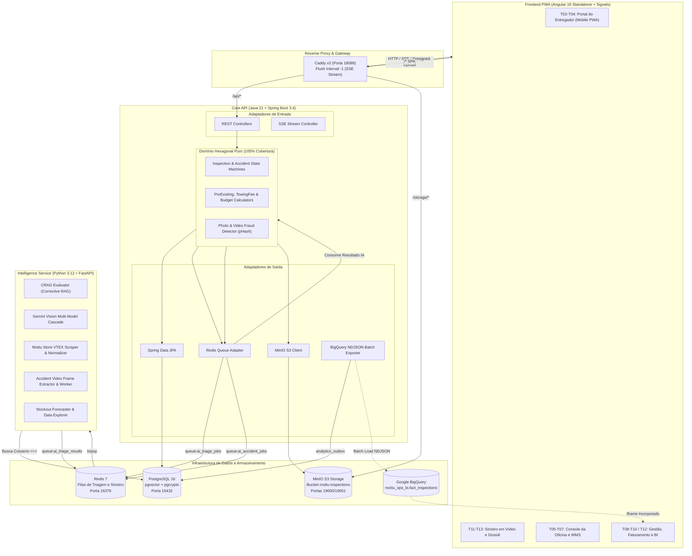

# Mottu Smart Ops — Sistema de Vistoria Inteligente, Telemetria e Operação de Frota

[](https://github.com/RobsonMendes37/motus-smart/releases)
[-05944F?style=for-the-badge&logo=oracle&logoColor=FFFFFF)](http://161.153.2.148:18088)
[](https://github.com/RobsonMendes37/motus-smart/actions)
[-05944F?style=for-the-badge&logo=vitest&logoColor=FFFFFF)](#qualidade-de-codigo-e-bateria-de-testes)
[](https://openjdk.org/)
[](https://spring.io/projects/spring-boot)
[](https://www.python.org/)
[](https://fastapi.tiangolo.com/)
[](https://angular.dev/)
[](https://tailwindcss.com/)
[](https://github.com/pgvector/pgvector)
[](https://redis.io/)
[](https://min.io/)
[](https://caddyserver.com/)
[](https://www.docker.com/)

> **Plataforma corporativa integrada de vistoria técnica, telemetria de pátio e inteligência operacional para locação de motocicletas em escala.**  
> Arquitetura hexagonal projetada para eliminar filas em galpões operacionais, automatizar a triagem de avarias e sinistros com IA Multimodal (Gemini Vision + Corrective RAG), mitigar fraudes documentais e integrar indicadores de oficina ao Google BigQuery e Looker Studio.

---

## Ambiente de Demonstração em Nuvem (Oracle Cloud)

O sistema encontra-se implantado e ativo em infraestrutura de nuvem pública:

* **URL de Acesso:** [http://161.153.2.148:18088](http://161.153.2.148:18088)
* **Acesso Rápido por Perfil:** Na tela inicial de autenticação, utilize o seletor de ambiente (**Demonstração** ou **Operação Real**) para acessar diretamente os painéis de **Entregador**, **Mecânico** ou **Gestor** com um único clique.

---

## Visão Executiva e Impacto Operacional

Em operações logísticas com dezenas de milhares de motocicletas em regime contínuo, o tempo de inatividade em oficina representa perda simultânea de receita recorrente para a locadora e de produtividade diária para o entregador parceiro.

O **Mottu Smart Ops** digitaliza o ciclo de vistoria e manutenção por meio de regras determinísticas de domínio e automação assistida:

* **Triagem Autônoma em Segundos:** Classificação de avarias por visão computacional a partir do dispositivo móvel, integrada ao catálogo oficial da Mottu Store (`loja.mottu.com.br`).
* **78,5% de Deflexão na Oficina:** Ocorrências de desgaste natural ou avarias pré-existentes são processadas automaticamente sem sobrecarregar a fila de mecânicos.
* **Governança Matemática de Orçamentos:**
  * **Pré-existente (`PRE_EXISTENTE`):** Contratos recentes ($\le 48\text{h}$ ou $\le 100\text{km}$ rodados desde a retirada) resultam em isenção integral (**R$ 0,00**).
  * **Desgaste Natural (`DESGASTE_NATURAL`):** Itens de consumo operacional periódico (pastilhas, lonas, relação) resultam em manutenção coberta (**R$ 0,00**).
  * **Mau Uso ou Avaria Acidental (`MAU_USO`):** Precificação tabelada sobre o catálogo oficial acrescida de taxa fixa de mão de obra (**R$ 35,00**).
* **Relato de Sinistro por Vídeo (`UC-18`):** Registro de acidentes em campo com captura de vídeo de até 30 segundos, extração e deduplicação temporal de frames, cálculo escalonado de mão de obra, taxa de guincho (**R$ 80,00**) e bloqueio preventivo da motocicleta (`IN_MAINTENANCE`).
* **Prevenção de Fraudes com Hash Perceptual (`pHash`):** Validação de metadados EXIF e distância de Hamming para bloquear o reaproveitamento de fotografias antigas ou imagens de terceiros.
* **Bancada de Decisão do Mecânico (`T06` e `T13`):** Fila priorizada por criticidade operacional (P1 a P4), equipada com lupa reticular interativa (zoom óptico de 2x a 4x) e comparativo com o Giro 360 de retirada.
* **Inteligência Executiva e Copiloto Operacional:** Exportação assíncrona via padrão *Transactional Outbox* (NDJSON) para o Google BigQuery e Looker Studio, acompanhada de assistente analítico integrado para consulta de estoque, frota e previsões de demanda (*What-If*).
* **Integração e Entrega Contínua (CI/CD):** Esteira automatizada via GitHub Actions com execução de testes de unidade, arquitetura, segurança e deploy remoto via OpenSSH.

---

## Arquitetura do Sistema



---

## Controle de Versão Semântica (SemVer) e Releases

O projeto adota o padrão **Semantic Versioning 2.0.0** (`MAJOR.MINOR.PATCH`) com publicação automatizada via Git Tags:

| Versão | Data | Escopo da Entrega |
| :--- | :--- | :--- |
| **`v1.0.0`** | Nov/2026 | Arquitetura Hexagonal, Vistoria Fotográfica, Bancada do Mecânico (`T01` a `T07`) e suíte TDD inicial. |
| **`v2.0.0`** | Nov/2026 | Integração com Catálogo Mottu Store (VTEX), exportação em lote para Google BigQuery e painel Looker Studio BI. |
| **`v2.1.0`** | Nov/2026 | Implantação em nuvem Oracle Cloud com isolamento de portas e proxy reverso Caddy. |
| **`v2.2.0`** | Nov/2026 | Módulo de Sinistro por Vídeo (`UC-18`), suíte E2E Playwright e pipeline de CI/CD no GitHub Actions. |
| **`v2.3.0`** | Nov/2026 | Design System *Mottu Clean Fleet* (`DESIGN.md` v2.0), login responsivo em tela dividida, conciliação Pix semanal, WMS de oficina e copiloto analítico. |

### Publicação de Nova Release

```bash
# 1. Criar uma tag anotada no Git
git tag -a v2.3.0 -m "Release v2.3.0: Mottu Clean Fleet UI e Inteligência Operacional"

# 2. Enviar a tag para o repositório remoto
git push origin v2.3.0

# 3. O pipeline do GitHub Actions (.github/workflows/cd.yml) realiza o deploy automaticamente
```

---

## Início Rápido (Execução Local via Docker)

A aplicação foi estruturada para execução local autônoma, sem dependência obrigatória de chaves externas de API (operando por padrão com `GEMINI_MOCK_MODE=true` e `BIGQUERY_ENABLED=false` para desenvolvimento e testes determinísticos):

```bash
# 1. Clonar o repositório
git clone https://github.com/RobsonMendes37/motus-smart.git
cd motus-smart

# 2. Copiar o arquivo de configuração de ambiente
cp .env.example .env

# 3. Iniciar os serviços via Docker Compose
docker compose -f infra/docker-compose.dev.yml up -d
```

### Mapeamento de Portas e Serviços

| Serviço | URL / Endpoint | Descrição |
| :--- | :--- | :--- |
| **Aplicação Web (Angular 19 PWA)** | [`http://localhost:18088`](http://localhost:18088) | Ponto de entrada público via proxy reverso Caddy |
| **Backend Core API (Spring Boot)** | [`http://localhost:18080`](http://localhost:18080) | API REST principal e orquestração de domínio hexagonal |
| **Swagger / OpenAPI (Core API)** | [`http://localhost:18080/swagger-ui.html`](http://localhost:18080/swagger-ui.html) | Documentação interativa dos contratos REST |
| **Intelligence Service (FastAPI)** | [`http://localhost:18000`](http://localhost:18000) | Serviço de visão computacional, CRAG, predição de estoque e scrapers |
| **Swagger / OpenAPI (Intelligence)** | [`http://localhost:18000/docs`](http://localhost:18000/docs) | Documentação interativa do serviço de IA |
| **MinIO Console (S3 Storage)** | [`http://localhost:19001`](http://localhost:19001) | Gerenciamento de buckets de fotos e vídeos (`minioadmin` / `minioadmin123`) |
| **PostgreSQL 16 + pgvector** | `localhost:15432` | Banco de dados relacional e vetorial (`mottu_ops`) |
| **Redis 7** | `localhost:16379` | Filas de processamento assíncrono e controle de idempotência |

---

## Credenciais de Acesso (Dados de Semente)

O banco de dados é inicializado automaticamente pelas migrações Flyway (`V2__seed_data.sql` e seguintes). Todos os perfis de demonstração e operação utilizam a senha padrão abaixo:

> **Senha Padrão:** `Mottu@2026!`

| Perfil | E-mail de Acesso | Vínculo Operacional | Escopo de Permissões |
| :--- | :--- | :--- | :--- |
| **Gestor (`MANAGER`)** | `gestor@mottu-ops.local` | Administração Global de Unidades | Aprovação de cadastros, catálogo de peças VTEX, conciliação financeira Pix e BI |
| **Mecânico (`MECHANIC`)** | `mecanico@mottu-ops.local` | Unidade Butantã (SP-04) | Fila priorizada (P1 a P4), bancada de inspeção óptica, gestão de frota e baias WMS |
| **Entregador (`RIDER`)** | `entregador@mottu-ops.local` | Moto `MOT1A23` (*Mottu Sport 110i*) | Garagem digital, abertura de vistorias, relato de sinistro por vídeo e faturas semanais |

---

## Catálogo de Telas e Módulos (`T01` a `T13`)

A interface implementa o Design System **Mottu Clean Fleet** (`DESIGN.md` v2.0), fundamentado em alto contraste diurno para leitura sob luz solar direta (`#F6F6F6` canvas, `#FFFFFF` superfícies, `#141414` tipografia primária e `#05944F` verde operacional Mottu), tipografia `Plus Jakarta Sans` combinada com `JetBrains Mono` para dados tabulares/placas, alvos de toque mínimos de 52px no mobile e restrição absoluta de tons violetas/roxos (*Purple Ban*).

### Autenticação e Acesso Público
* **`T01` — Login e Solicitação de Cadastro:** Layout responsivo em duas colunas para desktop (painel visual institucional à esquerda e módulo de autenticação à direita) com colapso automático para coluna única em dispositivos móveis. Inclui solicitação de cadastro para entregadores e mecânicos e alternador rápido entre *Demonstração* e *Operação Real*.

### Portal do Entregador (Mobile PWA)
* **`T02` — Minha Moto (Garagem Digital):** Exibição da placa em tipografia monoespaçada, hodômetro, situação contratual, registro fotográfico de estado zero (*Giro 360 de Retirada*) e histórico de chamados.
* **`T03` — Nova Vistoria (Wizard de 4 Ângulos):** Captura guiada (Avaria, Painel/Hodômetro, Frente e Detalhe), validação automática de luminosidade em canvas, seleção de condição de rodagem e envio com chave de idempotência.
* **`T04` — Resultado da Vistoria e Agendamento:** Acompanhamento em tempo real via Server-Sent Events (SSE), detalhamento transparente de peças e mão de obra, agendamento de horário em galpão e fluxo de contestação fundamentada.
* **`T04B` e `T04C` — Meus Dados e Aluguel Semanal:** Gestão de dados cadastrais, CNH, chave Pix e extrato semanal de locação integrado aos lançamentos de manutenção.
* **`T11` e `T12` — Relato e Laudo de Sinistro por Vídeo (`UC-18`):** Upload direto de vídeo (até 30s/30MB) via URL pré-assinada S3, checklist de segurança e orçamento preliminar de peças com navegação por *timestamp* do vídeo.

### Console da Oficina (Desktop e Tablet do Mecânico)
* **`T05` — Fila Inteligente da Oficina:** Ordenação estrita por prioridade operacional:
  1. **P1 — Risco de Segurança, Sinistro ou Moto Parada**
  2. **P2 — Contestação do Entregador**
  3. **P3 — Baixa Confiança da IA (< 80%)**
  4. **P4 — Alerta de Integridade / Suspeita de Foto Reutilizada**
* **`T06` — Bancada de Decisão do Mecânico:** Divisão 55% / 45% com lupa óptica interativa (2x a 4x), marcações de visão computacional (*bounding boxes*), comparativo com fotos de retirada, checklist dinâmico de peças e conversão do parecer técnico em comunicação clara ao entregador.
* **`T07` e Operações WMS — Gestão de Frota e Baias:** Controle de disponibilidade de motocicletas (`AVAILABLE`, `RENTED`, `IN_MAINTENANCE`), alocação de ordens de serviço por baia e localização física de peças por corredor/prateleira.
* **`T13` — Dossiê Físico de Sinistro:** Conferência lado a lado entre o vídeo enviado em campo e a perícia presencial na oficina, com consolidação do orçamento final.

### Painel Executivo do Gestor (Desktop)
* **`T08` — Aprovação de Cadastros e Vínculo Contratual:** Triagem de novos entregadores e mecânicos em gaveta lateral (*Slide-over Drawer* de 400px), exigindo o vínculo de motocicleta disponível para ativação do contrato.
* **`T09` — Catálogo Oficial de Peças (`loja.mottu.com.br`):** Sincronização sob demanda com a plataforma VTEX da Mottu Store, parametrização da mão de obra e edição protegida de preços (`priceOverridden`).
* **`T10` — Inteligência Operacional, Simulador de Estoque e Looker Studio BI:** Indicadores de deflexão da IA, simulação preditiva de ruptura de estoque por subsistema mecânico (7 a 90 dias), copiloto operacional Monalisa e painel analítico Looker Studio integrado ao BigQuery.
* **`T12-Web` — Contratos e Conciliação Semanal Pix:** Gestão financeira de faturas semanais de locação e rateio de manutenções.

---

## Qualidade de Código e Bateria de Testes

O projeto aplica **Test-Driven Development (TDD)** estrito e verificação de pureza arquitetural em todas as camadas:

| Módulo / Camada | Ferramental de Testes | Cobertura / Escopo | Status |
| :--- | :--- | :--- | :--- |
| **Core API (Java 21)** | JUnit 5 + Mockito + ArchUnit + TestRestTemplate | **351 testes** (100% de linhas no domínio via JaCoCo) | Aprovado |
| **Intelligence Service (Python 3.12)** | Pytest + Pytest-Asyncio + Pytest-Cov + Ruff/Mypy | **210 testes** (100% de cobertura no domínio + pureza AST) | Aprovado |
| **Web App (Angular 19)** | Vitest + Testing Library + Angular TestBed | **250 testes** em 38 suítes de componentes e serviços | Aprovado |
| **Suíte E2E e Auditoria de Rede** | Playwright Chromium Headless | **148 testes** E2E + Auditoria de Imagens e Rede (Zero 404) | Aprovado |
| **Total Consolidado** | **Execução Automatizada** | **959 verificações automatizadas** | **100% Aprovado** |

### Comandos de Verificação

```bash
# 1. Executar testes unitários, de integração, ArchUnit e JaCoCo na Core API Java
cd apps/core-api && ./mvnw clean verify

# 2. Executar testes e validação de cobertura 100% de domínio no serviço Python
cd apps/intelligence-service && pytest tests/ -v

# 3. Executar suíte de testes unitários e build de produção no frontend Angular
cd apps/web-app && npm run test:ci && npm run build

# 4. Executar suíte E2E Playwright
npx playwright test
```

---

## Documentação Técnica de Referência

A documentação detalhada de engenharia e produto encontra-se estruturada no diretório [`docs/`](docs/):

* [`docs/GUIA_ESTUDO_E_LOOKER.md`](docs/GUIA_ESTUDO_E_LOOKER.md) — Guia de arquitetura, decisões de engenharia (Staff/Tech Lead) e instruções de integração com Google BigQuery e Looker Studio.
* [`docs/01-PMD.md`](docs/01-PMD.md) — Product Management Document com regras de negócio, fluxos de exceção e matriz de telas.
* [`docs/02-ARQUITETURA-E-APIS.md`](docs/02-ARQUITETURA-E-APIS.md) — Contratos REST/JSON, modelagem SQL Flyway, topologia de filas Redis e variáveis de ambiente.
* [`docs/03-CASOS-DE-USO-TDD.md`](docs/03-CASOS-DE-USO-TDD.md) — Especificação de casos de uso (`UC-01` a `UC-18`) e critérios de aceite TDD.
* [`docs/PENDENCIAS_DO_HUMANO.md`](docs/PENDENCIAS_DO_HUMANO.md) — Guia rápido para configuração opcional de credenciais externas (Gemini API e Google Cloud) em produção.
* [`DESIGN.md`](DESIGN.md) e [`design/mottu-smart-ops.pen`](design/mottu-smart-ops.pen) — Especificação de tokens visuais e protótipo de telas.
* [`docs/HISTORICO_IA.md`](docs/HISTORICO_IA.md) — Registro histórico cronológico de desenvolvimento e decisões técnicas.

---

## Licença

Desenvolvido como case técnico e operacional para a **Mottu**.  
Distribuído sob a licença MIT. Consulte o arquivo `LICENSE` para mais informações.
