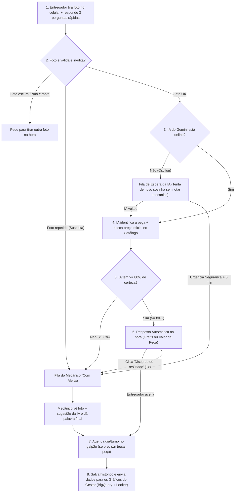

# PMD — Sistema de Vistoria Inteligente & Operação de Frota (Case Mottu)

**Versão:** 2.0 (Linguagem Simples + Regras Fechadas para Execução Autônoma e TDD)  
**Objetivo do Projeto:** Resolver a demora e as discussões sobre peças quebradas em motos alugadas usando Inteligência Artificial com supervisão de mecânicos humanos.

---

## 1. O Problema Real (Explicado de Forma Simples)

Imagine a rotina real de quem aluga uma moto para trabalhar com entregas:

1. **A dor do Entregador:** Ele pega uma moto no galpão e percebe um defeito que já estava lá, ou uma peça gasta pelo uso normal. Para provar que não quebrou a moto por culpa dele, ele perde horas indo até a oficina ou discutindo no suporte. E quando a culpa realmente foi de uma queda, ele toma um susto com o valor cobrado na hora.
2. **A dor do Mecânico:** Em vez de focar em consertar motos, o mecânico perde grande parte do dia apenas olhando fotos ou motos na fila para responder coisas óbvias.
3. **A dor do Gestor (Empresa):** Moto parada esperando avaliação não gera receita, gera fila no galpão e deixa o entregador insatisfeito.

### Como o nosso sistema resolve isso?
O entregador tira uma **foto do defeito pelo celular**. Em poucos segundos:
* Se o caso for **fácil e claro para a IA**, o sistema responde na hora se o conserto será **gratuito** ou **cobrado** (já mostrando o preço real da peça no site oficial da Mottu).
* Se a IA **ficar em dúvida**, se a **foto parecer suspeita** ou se o **entregador discordar da resposta**, o caso vai para a **fila do Mecânico**, já com um resumo pronto para ele decidir rápido.

---

## 2. Exemplos Práticos do Dia a Dia (Como o Sistema Pensa)

Para não restar nenhuma dúvida, veja **4 situações reais** de como o sistema funciona:

* **Caso 1 — Defeito que já veio na moto (`PRE_EXISTENTE` → Grátis):**
  João retirou a moto ontem (há menos de 48h e rodou só 35 km) e notou a carenagem trincada. Ele tira a foto e marca *"Já recebi assim"*. A IA vê a trinca, confere que o contrato começou ontem e aprova **conserto gratuito (`R$ 0,00`)**.
* **Caso 2 — Peça que gastou normalmente trabalhando (`DESGASTE_NATURAL` → Grátis):**
  Maria está com a moto há 4 meses, rodou 6.000 km e o freio começou a gastar sem nenhum sinal de batida na foto. A IA identifica desgaste normal de uso e libera **troca preventiva gratuita (`R$ 0,00`)**, pedindo apenas para ela agendar a ida ao galpão.
* **Caso 3 — Queda ou Mau Uso (`MAU_USO` → Cobrado com transparência):**
  Carlos deixou a moto cair, quebrou o manete de freio e ralou a lateral. A IA identifica quebra por impacto, busca o preço oficial na loja da Mottu (ex: Manete `R$ 25,00` + Mão de Obra `R$ 35,00` = `R$ 60,00`) e avisa com educação: *"Identificamos quebra por impacto. Prepare-se para o valor estimado de `R$ 60,00` ao levar no galpão — ou clique em 'Discordo' se quiser que um mecânico revise"*.
* **Caso 4 — Foto confusa ou dúvida da IA (Vai para o Mecânico):**
  Pedro manda foto de um vazamento de óleo difícil de ver. A IA fica com menos de 80% de certeza. Em vez de chutar errado, ela avisa: *"Encaminhamos sua foto para um mecânico avaliar com cuidado"* e coloca na fila da oficina.

---

## 3. Os 3 Tipos de Usuário do Sistema

Ninguém entra no sistema sem permissão. Veja quem faz o quê:

| Perfil | Como entra no sistema? | O que faz lá dentro? |
| :--- | :--- | :--- |
| **1. Entregador** *(Usa pelo Celular)* | Faz o próprio cadastro no site e **aguarda o Gestor aprovar**. | Vê os dados da sua moto, envia fotos de problemas, vê o resultado/preço, agenda ida ao galpão e pode clicar em **"Discordo do resultado"**. |
| **2. Mecânico** *(Usa Tablet ou PC no Galpão)* | Faz o próprio cadastro como mecânico e **aguarda o Gestor aprovar**. | Vê a fila de fotos que a IA teve dúvida ou que o entregador contestou, dá a palavra final e muda o status das motos na oficina. |
| **3. Gestor** *(Usa PC)* | Já vem cadastrado desde o início do sistema. | Aprova cadastros de entregadores/mecânicos, cadastra motos, clica no botão que **atualiza os preços direto da loja da Mottu**, edita preços se quiser e vê os **gráficos do Looker Studio**. |

> [!TIP]
> **Modo Seleção vs. Modo LinkedIn:** Enquanto você estiver no processo seletivo da Mottu, só entra quem tiver login aprovado (limite de **50 análises de IA por hora**). Depois, mudando apenas 1 configuração (`PUBLIC_DEMO_MODE=true`), o sistema libera botões de "Login Rápido de Teste" com limite de **5 análises por hora por pessoa** para você postar no LinkedIn sem gastar sua conta da IA.

---

## 4. Regras de Negócio Exatas (Sem Espaço para Dúvida)

> [!IMPORTANT]
> Estas regras têm **números fechados** de propósito. Assim, qualquer agente de IA (mesmo um modelo menor e mais rápido) sabe programar cada `if/else` sem precisar adivinhar nada, e conseguimos testar 100% delas com TDD.

### 4.1. Regras de Classificação e Preço
1. **Regra do Defeito Pré-existente (`PRE_EXISTENTE`):**
   * Só pode ser aprovado automaticamente como `PRE_EXISTENTE` se **TODAS** estas condições forem verdadeiras:
     * O entregador marcou *"Recebi a moto assim"*;
     * Faz **no máximo 48 horas** desde a entrega da moto no contrato **OU** a moto rodou **no máximo 100 km** desde a retirada;
     * Não há alerta de foto falsa/repetida.
   * Se o entregador marcar *"Recebi assim"*, mas já estiver com a moto há **mais de 48h e mais de 100 km**, o sistema **não aprova sozinho** — manda para o **Mecânico** avaliar.
   * **Valor para o entregador:** `R$ 0,00`.

2. **Regra do Desgaste Natural (`DESGASTE_NATURAL`):**
   * A peça está marcada no catálogo como *"Item de Desgaste Natural"* (ex: pneu, lona/pastilha de freio, kit relação, lâmpada, cabo) **E** a IA não viu sinais de batida/queda na foto.
   * **Valor para o entregador:** `R$ 0,00` (coberto pelo plano de aluguel).

3. **Regra de Mau Uso ou Batida (`MAU_USO`):**
   * A foto mostra sinais claros de queda, batida, peça quebrada por impacto ou peça que não sofre desgaste natural (ex: retrovisor quebrado, manete torto/partido, carenagem ralada).
   * **Fórmula exata do valor estimado:**
     * `Valor Total = Soma do Preço das Peças no Catálogo + Taxa Fixa de Mão de Obra (padrão: R$ 35,00, editável pelo Gestor)`.
   * Se aparecer **mais de uma peça quebrada na mesma foto**, a IA lista todas elas e soma os preços.

4. **Regra da Nota de Certeza da IA (`Confiança` de `0%` a `100%`):**
   * **Certeza maior ou igual a `80%` (`>= 0.80`):** O sistema responde automaticamente na hora para o entregador.
   * **Certeza menor que `80%` (`< 0.80`):** O sistema **não chuta**; envia o caso para a fila do Mecânico.

### 4.2. Tabela de Exceções ("Se acontecer X → O sistema faz Y")

| Situação / Problema | O que o sistema DEVE fazer exatamente |
| :--- | :--- |
| **Foto muito escura ou arquivo inválido** | Antes de enviar, o celular avisa se a foto estiver escura demais. Aceita apenas imagens (`JPG`, `PNG`, `WEBP`) de até **10 MB**. |
| **Foto não é de uma moto** *(ex: parede, rosto, cachorro)* | A IA marca como `FOTO_INVALIDA`, avisa na hora para o entregador tirar foto da peça da moto, **não cobra nada** e **não manda para o mecânico**. |
| **Foto repetida ou baixada da internet (Anti-Fraude)** | O sistema compara o código único da imagem com fotos antigas e checa os dados da câmera. Se for repetida ou suspeita, marca um alerta amarelo `SUSPEITA_FRAUDE` e manda **obrigatoriamente para o Mecânico** (nunca dá isenção automática). |
| **Entregador clica 5 vezes no botão porque o 3G travou** | O sistema usa um código único do clique (`Idempotency-Key`) e cria **apenas 1 chamado**, ignorando os cliques repetidos. |
| **Entregador já tem chamado em aberto na mesma moto** | Permite até **3 chamados em andamento** (status `QUEUED_AI`, `AWAITING_AI_RECOVERY` ou `HUMAN_TRIAGE`), bloqueando abrir o 4º chamado até que algum dos anteriores seja resolvido. |
| **Entregador não concorda com a IA ("Discordo")** | O entregador pode clicar **1 única vez por chamado** em *"Discordo do resultado"*, escrevendo o motivo (mínimo 10 letras). O caso vai para o Mecânico. Depois que o Mecânico responde, a decisão é **definitiva** (o botão não aparece de novo). |
| **A IA do Google (Gemini) caiu ou ficou lenta** | **NÃO joga as fotos nos mecânicos** (para não lotar a oficina!). As fotos ficam numa **Fila de Espera da IA (`AGUARDANDO_IA`)** tentando de novo a cada `30s → 1min → 5min`. **Única exceção:** se o entregador marcou *"Risco grave de segurança / Moto parada"* e a IA não voltar em **5 minutos**, aí sim esse caso urgente vai para o topo da fila do Mecânico! |
| **Site da loja da Mottu mudou ou ficou fora do ar** | Quando o Gestor clicar em *"Atualizar Catálogo"* e o site externo falhar, o sistema mostra um aviso amigável e **mantém todos os preços da última atualização válida** funcionando normalmente. |

---

## 5. Passo a Passo do Fluxo Completo (Diagrama Fácil)

---

## 6. Todas as 10 Telas Detalhadas (Guia Exato para o `pen.dev` e Front-end)

Abaixo está exatamente o que deve existir em cada tela (cores base oficiais do `DESIGN.md`: **Fundo Asfalto `#0A0E0D`**, **Cartões `#121816`**, **Verde Mottu `#00E676`** com texto escuro `#06120B` nos botões principais, letras grandes e zero cor roxa):

### Área Pública (Login e Cadastro)
* **`T01` — Login e Criar Conta:**
  * **Aba Entrar:** Campos `E-mail` e `Senha` + botão verde `Entrar`. Se o cadastro ainda não foi aprovado pelo Gestor, mostra aviso claro: *"Seu cadastro está aguardando aprovação do Gestor"*.
  * **Aba Criar Conta:** Escolha `Sou Entregador` ou `Sou Mecânico`, campos `Nome Completo`, `CPF`, `Telefone`, `E-mail`, `Senha` + botão `Solicitar Cadastro`.

### Área do Entregador (Feita para Tela de Celular)
* **`T02` — Minha Moto (Tela Inicial do Entregador):**
  * Cartão no topo mostrando: Modelo da moto (ex: *Mottu Sport 110i*), Placa, Data em que pegou a moto, Quilometragem atual e Status (`Rodando Normal`, `Em Análise`, `Manutenção Agendada`).
  * Botão grande verde no centro: **`📸 Reportar Defeito / Nova Vistoria`**.
  * Lista abaixo: *"Meus Chamados Recentes"* com etiqueta colorida do status de cada um.
* **`T03` — Nova Vistoria (3 Passos Simples):**
  * **Passo 1 (Foto):** Abre a câmera com um quadrado guia no meio + aviso se estiver escuro demais (ou permite escolher foto no teste).
  * **Passo 2 (Contexto Rápido):**
    * Botões de escolha única: `[Já recebi a moto assim]` | `[Gastou no uso normal]` | `[Tive queda / batida]`;
    * Pergunta de segurança: `[Consigo continuar rodando]` vs. `[Risco de segurança / Moto parada]`;
    * Campo numérico: `Quilometragem atual no painel`;
    * Campo de texto curto (opcional): `Conte rapidamente o que houve (até 300 letras)`.
  * **Passo 3:** Botão verde `Enviar para Análise`.
* **`T04` — Resultado da Vistoria e Agendamento:**
  * Enquanto analisa (alguns segundos): mostra barra de progresso ao vivo (*"Recebendo foto → Consultando catálogo de peças → Gerando resultado"*).
  * Quando termina, mostra cartão claro:
    * **Resultado:** `Coberto sem custo (R$ 0,00)` **OU** `Reparo cobrado — Valor estimado: R$ XX,XX` (listando o preço da peça oficial + mão de obra);
    * **Explicação amigável:** Texto simples explicando o motivo;
    * **Botão Principal:** `Agendar Ida ao Galpão` (abre escolha rápida de Galpão, Data e Turno: Manhã ou Tarde) ou `Entendi, obrigado`;
    * **Link discreto no rodapé do cartão:** `Discordo do resultado — pedir revisão de um mecânico` (abre caixinha para escrever o motivo e envia para a oficina).

### Área do Mecânico (Feita para Tablet / Computador da Oficina)
* **`T05` — Fila Inteligente da Oficina:**
  * Mostra **apenas** o que precisa de humano, já na ordem certa de urgência:
    1. 🔴 **Risco de Segurança / Moto Parada** (`#FF4D4F`)
    2. 🟠 **Contestação do Entregador ("Discordo")** (`#FFB300`)
    3. 🟡 **IA ficou em dúvida (`< 80%`)** (`#FFB300`)
    4. 🔵 **Alerta de Foto Suspeita / Repetida** (`#29B6F6` — *proibido usar roxo*)
  * Filtros simples no topo por tipo e busca por placa.
* **`T06` — Tela de Decisão do Mecânico:**
  * **Lado Esquerdo:** Foto grande do defeito com botão de Zoom + dados da moto, há quantos dias está com o entregador, km rodados e o texto do entregador (incluindo o motivo caso ele tenha clicado em *"Discordo"*).
  * **Lado Direito:** Caixa mostrando o que a IA achou + campos prontos para o mecânico confirmar ou trocar:
    * Escolha do Veredito Final: `Pré-existente (Grátis)` | `Desgaste Natural (Grátis)` | `Mau Uso (Cobrado)`;
    * Busca de Peça do Catálogo (já vem preenchida com a sugestão da IA, mas o mecânico pode trocar ou adicionar peças);
    * Observação rápida do mecânico (a IA transforma essa anotação curta em uma resposta educada para o entregador) + botão `Finalizar Laudo`.
* **`T07` — Motos do Galpão (Cadastro e Status):**
  * Tabela simples com todas as motos cadastradas (Placa, Modelo, Galpão, Com quem está alugada, Status atual). Permite cadastrar moto nova e mudar o status rapidamente (`Disponível`, `Alugada`, `Na Oficina`).

### Área do Gestor (Feita para Computador)
* **`T08` — Aprovar Cadastros e Contratos:**
  * Lista de Entregadores e Mecânicos que criaram conta e estão esperando liberação.
  * Botões `Aprovar` (se for entregador, já escolhe qual moto disponível do galpão vai ficar com ele) e `Recusar`.
* **`T09` — Catálogo de Peças e Preços (`loja.mottu.com.br`):**
  * No topo: Botão **`🔄 Atualizar Preços do Site da Mottu`**, mostrando a data da última atualização e quantas peças foram sincronizadas.
  * Abaixo: Tabela completa com busca por nome da peça e filtro por moto (*Mottu Sport 110i, Pop 110i, Apache 160, Raider 125*). O Gestor pode clicar no preço, na taxa de mão de obra ou na chave *"Coberto como Desgaste Natural (Sim/Não)"* e salvar na hora.
* **`T10` — Painel de Indicadores (Looker Studio Embutido):**
  * 4 cartões rápidos no topo (Motos Ativas, % Resolvido pela IA sem Mecânico, Fila Atual da Oficina, Economia de Horas) + o **Relatório Interativo do Google Looker Studio** aberto direto dentro da página (alimentado pelo Google BigQuery).

---

## 7. Estratégia de Qualidade e TDD (Como Garantir Código Perfeito com IAs Menores)

Você pediu para usarmos **TDD** e buscarmos **altíssima cobertura de testes** de um jeito que até uma IA mais fraca consiga executar sem quebrar o projeto. Funciona assim:

> [!WARNING]
> **Por que fazer o Teste ANTES (TDD real) é muito melhor do que fazer no final?**  
> Quando uma IA mais fraca escreve todo o código primeiro e só cria os testes no final, se ela tiver errado uma regra de negócio, ela acaba criando um teste viciado que "aprova" o próprio erro!  
> No **TDD Real**, nós fazemos o inverso: **1º escrevemos o teste cobrando a regra deste documento → 2º o teste fica Vermelho (falha) → 3º a IA escreve o código até o teste ficar Verde!** O teste funciona como um trilho de trem que impede a IA menor de errar.

### Meta Realista e Rigorosa de Cobertura Automatizada
1. **100% de Cobertura Obrigatória no Coração do Sistema (`Regras de Negócio / Domínio`):**
   * Todas as regras da **Seção 4** (cálculo de 48h/100km, cálculo de valor da peça + mão de obra, bloqueio de foto repetida, limite de 1 contestação, fila de espera quando a IA cai, nota `< 80%` indo pro mecânico) terão **100% das linhas e condições testadas** (travado automaticamente pelo verificador de cobertura no Java, Python e Angular).
2. **Testes de Integração em 100% das Rotas de API:**
   * Cada endereço da API (login, cadastro, envio de vistoria, decisão do mecânico, sincronização de peças) terá teste simulando chamadas reais ao banco de dados para garantir que nada quebre na integração.
3. **Sem "Testes Inúteis de Encher Linguiça":**
   * Arquivos vazios de configuração inicial do framework são ignorados na conta para que os 100% representem **regras reais funcionando**, exatamente como as grandes empresas de tecnologia cobram.

---

## 8. O que NÃO Faremos Agora (Para Não Perder o Foco)
* **Cobrança bancária real (PIX/Cartão):** O sistema calcula e informa o orçamento oficial exato para o entregador se preparar e agenda a ida ao galpão, mas não movimenta dinheiro real em banco.
* **App de loja (Google Play / App Store):** Como será um **PWA (Site Instalável)**, ele abre direto pelo navegador do celular e pode ser adicionado na tela inicial igual a um aplicativo sem burocracia de loja.
