# Guia Completo de Fluxos de Demonstração — Mottu Smart Ops

> **Documento Oficial de Apresentação e Demonstração Operacional**  
> **Versão do Sistema:** 2.2.0 (Uber Clean Fleet — Design System v2.0)  
> **Ambiente de Demonstração Online:** [https://mottu-smart.duckdns.org](https://mottu-smart.duckdns.org) *(ou https://161.153.2.148.sslip.io)*

---

## 1. Visão Geral dos Perfis e Acesso Rápido

O sistema possui **Login Rápido de 1-Clique** na tela de autenticação (`/auth/login`). Você não precisa digitar senhas manualmente durante a apresentação; basta clicar no card do perfil desejado:

| Perfil | Email Oficial Seed | Senha Seed | Rota Principal | Objetivo no Fluxo |
| :--- | :--- | :--- | :--- | :--- |
| **🛵 Entregador (Rider)** | `rider@mottu.com` | `Mottu@2026!` | `/rider/garage` | Visualizar sua moto, abrir vistorias inteligentes por foto, reportar sinistro em vídeo e agendar manutenção no galpão. |
| **🔧 Mecânico (Oficina)** | `mecanico@mottu-ops.local` | `Mottu@2026!` | `/mechanic/queue` | Acessar a fila ordenada por risco/SLA, inspecionar avarias com lupa interativa (Bancada 55%/45%) e validar dossiês de acidentes. |
| **📊 Gestor (Operações)** | `gestor@mottu-ops.local` | `Mottu@2026!` | `/manager/bi` | Monitorar KPIs em tempo real, aprovar novos entregadores, cadastrar motos na frota, sincronizar peças com a Loja Mottu e gerenciar custos. |

---

## 2. Mapa dos 5 Fluxos Principais 100% Funcionais Online

```mermaid
flowchart TD
    subgraph FLUXO_1["Fluxo 1: Vistoria Inteligente por Foto (Entregador)"]
        A1["1. Garagem do Entregador (/rider/garage)"] --> A2["2. Nova Vistoria (/rider/inspection/new)"]
        A2 --> A3["3. Upload S3 Presigned (MinIO)"]
        A3 --> A4["4. Triagem IA Gemini + CRAG"]
        A4 --> A5["5. Parecer Automático R$ 0,00 (/rider/inspection/:id)"]
        A5 --> A6["6. Agendamento Galpão (/rider/appointment/new)"]
    end

    subgraph FLUXO_2["Fluxo 2: Sinistro em Vídeo (Entregador)"]
        B1["1. Garagem (/rider/garage)"] --> B2["2. Reportar Acidente (/rider/accident/new)"]
        B2 --> B3["3. Upload Vídeo 360°"]
        B3 --> B4["4. IA Worker Gemini Video"]
        B4 --> B5["5. Dossiê e Orçamento Preliminar (/rider/accident/:id)"]
    end

    subgraph FLUXO_3["Fluxo 3: Fila da Oficina e Bancada (Mecânico)"]
        C1["1. Fila de Triagem (/mechanic/queue)"] --> C2["2. Bancada 55%/45% (/mechanic/inspection/:id)"]
        C2 --> C3["3. Lupa de Foto PhotoZoomLens (2.5x)"]
        C3 --> C4["4. Parecer Técnico e Conclusão"]
        C1 --> C5["5. Dossiê Sinistro (/mechanic/accident/:id)"]
    end

    subgraph FLUXO_4["Fluxo 4: Governança de Frota e Usuários (Gestor)"]
        D1["1. Gestão da Frota (/manager/fleet)"] --> D2["2. Cadastro Moto Mercosul (Drawer 400px)"]
        D1 --> D3["3. Aprovação de Entregadores (/manager/approvals)"]
        D3 --> D4["4. Vínculo Moto-Entregador"]
    end

    subgraph FLUXO_5["Fluxo 5: Loja Mottu e Business Intelligence (Gestor)"]
        E1["1. Catálogo de Peças (/manager/catalog)"] --> E2["2. Sync Ao Vivo VTEX (loja.mottu.com.br)"]
        E2 --> E3["3. Edição Manual Preço (priceOverridden)"]
        E1 --> E4["4. Dashboard Operacional BI (/manager/bi)"]
    end
```



---

## 3. Roteiro Passo a Passo de Demonstração

### 🛵 FLUXO 1 — Vistoria de Avaria com Isenção 48h e Agendamento no Galpão
> **Objetivo:** Mostrar como a inteligência artificial resolve chamados sem atrito para o entregador, aplicando a regra de negócio Mottu (isenção total em avarias identificadas nas primeiras 48h de locação ou desgaste natural de peças como lona e pastilha).

1. **Acesso:** Faça login como **Entregador** (`rider@mottu.com`).
2. **Tela Garagem (`/rider/garage`):**
   * Mostra os dados da moto alugada (ex: placa `MOT-2026`, modelo `Mottu Sport 110i`).
   * Clique no botão de ação principal verde: **"Reportar Avaria"**.
3. **Wizard de Vistoria (`/rider/inspection/new`):**
   * Selecione a origem do dano: *Retirada da Moto (Check-in)* ou *Uso Operacional*.
   * Selecione o nível de gravidade: *Baixo (Estético/Ralado)*, *Médio* ou *Alto*.
   * Tire ou anexe uma foto da avaria (a aplicação gera a URL pré-assinada segura no MinIO e faz o upload direto).
   * Clique em **"Enviar para Análise"**.
4. **Resultado da Triagem IA (`/rider/inspection/:id`):**
   * O sistema exibe o parecer em tempo real:
     * **Veredito:** `PRE_EXISTENTE` ou `DESGASTE_NATURAL`.
     * **Cobrança:** **R$ 0,00 (Isento)**.
     * **Mensagem Amigável:** Texto polido pela IA explicando que por estar nas 48h de locação ou ser desgaste de uso, o entregador não paga nada pelo reparo.
5. **Agendamento no Galpão (`/rider/appointment/new`):**
   * Na mesma tela, clique em **"Agendar Reparo no Galpão"**.
   * Selecione a unidade (ex: *Galpão Tietê - SP*), a data desejada e o turno (*MANHÃ* ou *TARDE*).
   * Confirmação imediata com protocolo gerado na tela.

---

### 🛵 FLUXO 2 — Sinistro / Acidente em Vídeo (UC-13)
> **Objetivo:** Demonstrar a tecnologia pioneira de análise de acidentes por vídeo 360°, onde a IA detecta múltiplas peças quebradas e monta o orçamento preliminar antes mesmo da moto chegar ao galpão.

1. **Acesso:** Na Garagem do Entregador (`/rider/garage`), clique no botão secundário **"Declarar Sinistro / Acidente"**.
2. **Upload e Relato (`/rider/accident/new`):**
   * Informe a data/hora aproximada do acidente e uma descrição sumária.
   * Faça upload de um clipe de vídeo da moto (MP4 ou WebM).
   * Clique em **"Registrar Sinistro"**.
3. **Acompanhamento do Sinistro (`/rider/accident/:id`):**
   * O worker em background analisa os frames do vídeo.
   * Apresenta a lista de componentes avariados identificados com timestamp e o orçamento preliminar baseado no catálogo oficial.

---

### 🔧 FLUXO 3 — Fila da Oficina e Bancada do Mecânico com Lupa de Inspeção
> **Objetivo:** Demonstrar como o mecânico opera com eficiência de rua: fila priorizada por gravidade (SLA de segurança) e tela dividida 55%/45% com lupa interativa de alta resolução.

1. **Acesso:** Faça login como **Mecânico** (`mecanico@mottu-ops.local`).
2. **Fila da Oficina (`/mechanic/queue`):**
   * Veja os chamados organizados por prioridade:
     * 🔴 **Risco Alto (SLA 2h):** Freios, direção, garfo dianteiro.
     * 🟡 **Risco Médio (SLA 4h):** Transmissão, iluminação.
     * 🟢 **Risco Baixo:** Estética, retrovisor ralado.
   * Clique em um chamado da lista para abrir a bancada.
3. **Bancada de Trabalho 55% / 45% (`/mechanic/inspection/:id`):**
   * **Lado Esquerdo (55%):**
     * Foto original da avaria com o componente **`PhotoZoomLensComponent`**.
     * Passe o mouse (ou toque na tela) para ativar a **lupa de 2.5x** e examinar trincas no manete, profundidade do sulco do pneu ou riscos na carenagem.
   * **Lado Direito (45%):**
     * Análise sugerida pela IA (confiança %, peças correspondentes e preços).
     * Três botões grandes de parecer final (52px de altura, ideais para luvas):
       * `[Confirmar Pré-Existente (R$ 0,00)]`
       * `[Confirmar Desgaste Natural (R$ 0,00)]`
       * `[Cobrar Mau Uso / Queda]`
     * Campo para observação técnica do mecânico.
   * Clique em **"Concluir Inspeção"** para liberar a moto ou encaminhar para reparo.

---

### 📊 FLUXO 4 — Gestão de Frota e Aprovação de Entregadores (Gestor)
> **Objetivo:** Mostrar o controle corporativo da frota em tempo real e a esteira de admissão de novos motoristas com interface rápida em Drawers laterais de 400px.

1. **Acesso:** Faça login como **Gestor** (`gestor@mottu-ops.local`).
2. **Controle de Frota (`/manager/fleet`):**
   * Lista completa das motocicletas cadastradas com status: *Em Operação*, *Em Manutenção*, *Disponível no Pátio*.
   * Clique no botão **"Nova Motocicleta"**:
     * Abre um **Drawer lateral de 400px** sem recarregar a tela.
     * Digite a placa (formata automaticamente para padrão Mercosul `ABC1D23`), selecione o modelo (`Mottu Sport 110i`, `TVS Apache 160`, etc.) e o chassi.
     * Salve e veja a moto aparecer instantaneamente na tabela.
3. **Aprovação de Entregadores (`/manager/approvals`):**
   * Visualização dos novos cadastros pendentes de validação de CNH/CPF.
   * Clique em **"Aprovar"**: abre o Drawer lateral para vincular uma moto disponível no pátio e ativar o contrato de locação.

---

### 📊 FLUXO 5 — Catálogo Inteligente com Loja Mottu e Dashboard BI
> **Objetivo:** Demonstrar o web scraping minerando peças reais da loja VTEX ao vivo, a autonomia do gestor para editar preços e o painel analítico com gráficos operacionais e Looker Studio.

1. **Catálogo de Peças (`/manager/catalog`):**
   * Exibe as peças e consumíveis oficiais com preços em R$, fotos reais e compatibilidade com os modelos da frota.
   * Clique no botão **"Sincronizar Loja Mottu"**:
     * O backend executa o web scraping contra `https://www.loja.mottu.com.br`.
     * Minera em lotes paralelos os **1.297 produtos oficiais** em ~4 segundos.
     * Atualiza os preços e fotos sem derrubar preços que o gestor tenha alterado manualmente (`priceOverridden = true`).
   * **Edição de Preço:** Clique em uma peça, abra o Drawer e ajuste o valor. Uma tag indica que o preço foi personalizado pelo gestor.
2. **Dashboard de Business Intelligence (`/manager/bi`):**
   * **KPIs no Topo:** Total de vistorias, % de isenções concedidas pela IA, tempo médio de atendimento na oficina e economia de custos operacionais.
   * **Gráfico de 7 Dias:** Volume diário de chamados comparando dias úteis e finais de semana.
   * **Distribuição de Pareceres:** Gráfico de pizza/barras com proporção entre *Pré-Existente*, *Desgaste Natural* e *Mau Uso*.
   * **Looker Studio:** Painel interativo incorporado para auditoria executiva.

---

## 4. Novas Rotas Complementares do Design System Uber Clean Fleet

Para garantir completude visual conforme o protótipo `design/mottu-smart-ops.pen`, as seguintes rotas já estão disponíveis e estilizadas:

* **`/rider/account`:** Perfil do entregador, dados de contato e preferências.
* **`/rider/rental`:** Dados do plano de locação, dias restantes e histórico de pagamentos.
* **`/mechanic/operations`:** Relatório de produtividade da oficina e peças mais trocadas no dia.
* **`/manager/billing`:** Faturamento consolidado de peças, custos de manutenção por filial e cobranças de mau uso.
* **`/staff/account`:** Perfil corporativo do gestor e configurações de sistema.

---

## 5. Como Executar Testes Automatizados da Interface Online

Você pode testar e validar o sistema online de três formas complementares:

### Opção A: Executar os Testes E2E do Playwright Diretamente contra a VM
Basta apontar a variável `E2E_BASE_URL` para o endereço da VM. O Playwright executará toda a suíte de ponta a ponta simulando as requisições e regras de negócio:

```bash
# Na raiz do projeto:
cd e2e
E2E_BASE_URL=http://161.153.2.148:18088 npx playwright test tests/tier4-scenarios/
```

### Opção B: Rodar Teste Visual em Navegador Real (Headless Chromium)
O Playwright pode abrir um navegador Chromium real em segundo plano, visitar as URLs da VM, clicar nos botões de 1 clique, preencher formulários e capturar capturas de tela (screenshots) das telas ao vivo:

```bash
# Exemplo de execução interativa com gravação de passos:
cd e2e
E2E_BASE_URL=http://161.153.2.148:18088 npx playwright test --headed
```

### Opção C: Script Automatizado de Verificação Rápida
Executar o script Python/Bash de verificação contínua que autentica em cada perfil, dispara o upload de vistoria, simula a triagem da IA e confere a integridade do catálogo e da fila.

